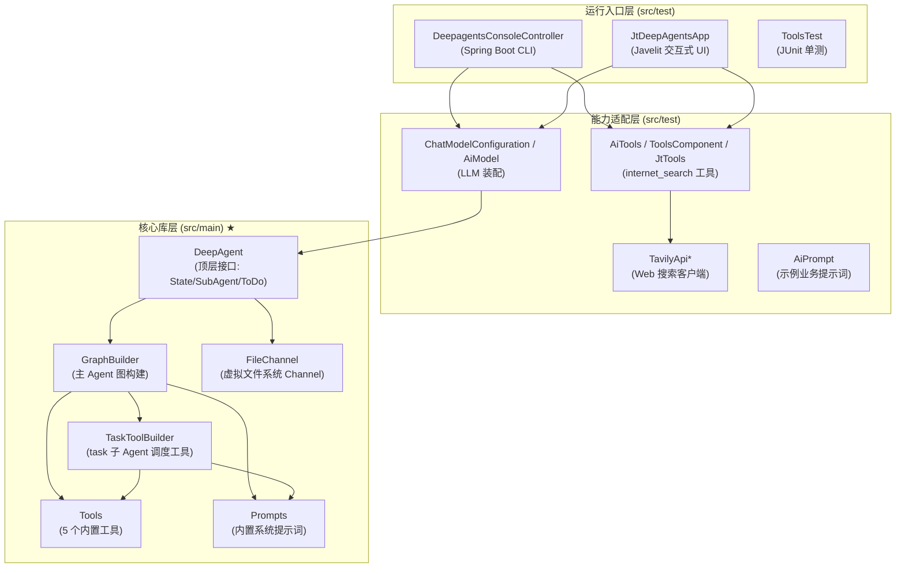
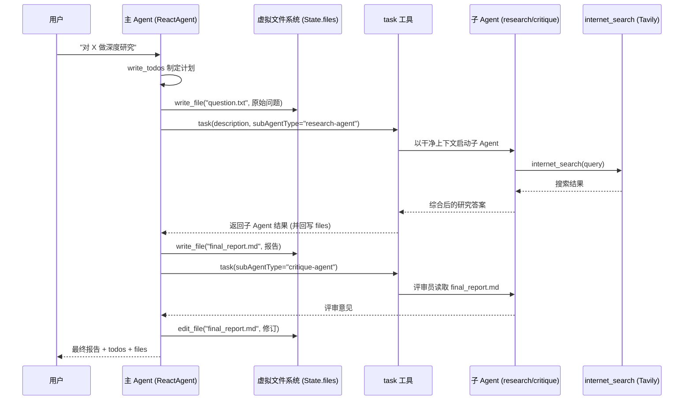

# 01 · 架构总览

[← 返回首页](./README.md)

本章帮助你建立对整个项目的「心智模型」：它想解决什么问题、用什么架构解决、运行时数据如何流动。

---

## 1. 为什么需要 Deep Agents？

经典 Agent 是一个简单循环：**思考 → 调用工具 → 观察结果 → 重复**。对于一次性、事务型的小任务很好用，但在「多小时 / 多天」的复杂任务上会退化：幻觉、丢失目标、死循环、无法恢复。

**Deep Agents 的思路是「改架构，而不只是改提示词」**，落在四大支柱上：

| 支柱 | 含义 | 在本项目中的落点 |
| --- | --- | --- |
| **① 显式规划 (Explicit Planning)** | Agent 持续维护一份 TODO 计划（带状态），而不是把意图藏在思维链里 | `write_todos` 工具 + [ToDo](file:///Users/bytedance/Documents/git_repo/langgraph4j-deepagents/src/main/java/org/bsc/langgraph4j/deepagents/DeepAgent.java#L85-L98) 记录 + State.todos() |
| **② 层级委派 (Sub-Agents)** | 主编排器把子任务委派给专职子 Agent（研究员、评审员……），各自在干净的上下文中工作 | `task` 工具 + [TaskToolBuilder](file:///Users/bytedance/Documents/git_repo/langgraph4j-deepagents/src/main/java/org/bsc/langgraph4j/deepagents/TaskToolBuilder.java) + [SubAgent](file:///Users/bytedance/Documents/git_repo/langgraph4j-deepagents/src/main/java/org/bsc/langgraph4j/deepagents/DeepAgent.java#L36-L83) |
| **③ 持久化记忆 (Persistent Memory)** | 中间产物（笔记、代码、报告）写入外部存储，按路径引用，而不是塞满上下文窗口 | `ls / read_file / write_file / edit_file` 工具 + [FileChannel](file:///Users/bytedance/Documents/git_repo/langgraph4j-deepagents/src/main/java/org/bsc/langgraph4j/deepagents/FileChannel.java) 虚拟文件系统 |
| **④ 极致上下文工程** | 用长而具体的系统提示词，规定「何时规划 / 何时委派 / HITL 规则」 | [Prompts.java](file:///Users/bytedance/Documents/git_repo/langgraph4j-deepagents/src/main/java/org/bsc/langgraph4j/deepagents/Prompts.java) 中的大段内置提示词 |

> ⚠️ README 明确标注：**HITL（人机协同）当前尚未实现**。

---

## 2. 分层结构

项目在逻辑上分为三层：**核心库层（`src/main`）→ 能力适配层（`src/test` 的模型/工具）→ 运行入口层（`src/test` 的三种启动方式）**。



- **核心库层**是真正可复用的部分，不依赖任何具体 LLM 或搜索引擎。
- **能力适配层**把具体的 LLM 提供商（OpenAI/Ollama/Gemini/GitHub）和 Tavily 搜索「插」进核心库。
- **运行入口层**提供三种把 Agent 跑起来的方式（详见 [05 · 运行与配置](./05-运行与配置.md)）。

---

## 3. 一个 Deep Agent 是怎么被组装出来的？

以示例中的「深度研究员 Agent」为例（见 [DeepagentsConsoleController.runDeepagentsWithSubAgents](file:///Users/bytedance/Documents/git_repo/langgraph4j-deepagents/src/test/java/org/bsc/langgraph4j/deepagents/DeepagentsConsoleController.java#L52-L132)），组装过程如下：

```
DeepAgent.builder()                               // → 返回 GraphBuilder
    .instructions(主 Agent 的业务提示词)            // 会自动拼接 Prompts.BASE_PROMPT
    .subAgents([research-agent, critique-agent])  // 声明两个子 Agent
    .chatModel(chatModel)                         // 注入 LLM
    .tools([internet_search])                     // 注入业务工具
    .build()      // GraphBuilder.build(): 组装工具集 + 构建 task 工具 + 产出 StateGraph
    .compile(...) // 编译为可执行的 CompiledGraph
```

[GraphBuilder.build()](file:///Users/bytedance/Documents/git_repo/langgraph4j-deepagents/src/main/java/org/bsc/langgraph4j/deepagents/GraphBuilder.java#L51-L98) 内部做了三件关键的事：

1. **汇总工具集** = 内置工具（`Tools.BUILTIN`，可被 `builtinTools` 过滤）+ 业务工具（如 `internet_search`）。
2. **按需生成 `task` 工具**：若声明了 `subAgents`，用 [TaskToolBuilder](file:///Users/bytedance/Documents/git_repo/langgraph4j-deepagents/src/main/java/org/bsc/langgraph4j/deepagents/TaskToolBuilder.java) 为每个子 Agent 预编译一个独立的 `ReactAgent`，再包装成单个名为 `task` 的工具。
3. **拼接系统提示词** = 用户 `instructions` + [Prompts.BASE_PROMPT](file:///Users/bytedance/Documents/git_repo/langgraph4j-deepagents/src/main/java/org/bsc/langgraph4j/deepagents/Prompts.java#L9-L22)，最终交给 `ReactAgent` 构建 `StateGraph<DeepAgent.State>`。

> 核心洞察：**整个 Deep Agent 本质上就是一个 ReactAgent（ReAct 循环），只是它被塞入了一组「特制工具」**——规划工具、虚拟文件系统工具、以及能启动子 Agent 的 `task` 工具。「深度」不是靠新的图节点，而是靠工具 + 提示词 + 共享状态实现的。

---

## 4. 运行时数据流

下图展示一次「深度研究」请求的运行时序（对应仓库根目录的 `deep_agents_seq.png`）：



关键点：

- **状态共享**：主 Agent 与子 Agent 共享同一套 `State`（`messages` + `todos` + `files`）。子 Agent 执行后，其 `files` 会被合并回主状态（见 [TaskToolBuilder.build()](file:///Users/bytedance/Documents/git_repo/langgraph4j-deepagents/src/main/java/org/bsc/langgraph4j/deepagents/TaskToolBuilder.java#L104-L141) 中 `.update(Map.of("files", ...))`）。
- **文件系统是协作媒介**：`question.txt`、`final_report.md` 既是记忆，也是主 Agent 和子 Agent 之间传递产物的「信箱」。
- **上下文隔离**：子 Agent 在独立的 `ReactAgent` 中运行，拥有自己干净的消息上下文，只把最终结论返回主 Agent，避免污染主上下文。

---

## 5. 状态模型（State）

Deep Agent 的所有运行时信息都装在 [DeepAgent.State](file:///Users/bytedance/Documents/git_repo/langgraph4j-deepagents/src/main/java/org/bsc/langgraph4j/deepagents/DeepAgent.java#L17-L34) 里，它继承自 `AgentExecutor.State`：

| 状态键 | 类型 | 说明 | 由谁更新 |
| --- | --- | --- | --- |
| `messages` | 消息列表 | ReAct 对话历史（继承自父类 Schema） | ReactAgent 运行时 |
| `todos` | `List<ToDo>` | 显式规划清单，每项含 content + status(PENDING/IN_PROGRESS/COMPLETED) | `write_todos` 工具 |
| `files` | `Map<String,String>` | 虚拟文件系统（文件名 → 内容） | `write_file`/`edit_file`/子 Agent 回写 |

`files` 键使用了自定义的 [FileChannel](file:///Users/bytedance/Documents/git_repo/langgraph4j-deepagents/src/main/java/org/bsc/langgraph4j/deepagents/FileChannel.java)，其 Reducer 语义为「**增量合并，同名覆盖**」（`mergeMap(old, new, (v1,v2)->v2)`），因此多次 `write_file` 会累积文件，而非整体替换。

---

## 6. 与 Python 原版的关系

- 本项目是 Python [deepagents](https://github.com/hwchase17/deepagents) 的 Java 移植。
- [Prompts.java](file:///Users/bytedance/Documents/git_repo/langgraph4j-deepagents/src/main/java/org/bsc/langgraph4j/deepagents/Prompts.java) 中的 `WRITE_TODOS_DESCRIPTION`、`TASK_DESCRIPTION_*`、`EDIT_DESCRIPTION`、`TOOL_DESCRIPTION` 都标注了「Ported exactly from Python」，即与原版提示词逐字对齐，以保证行为一致。
- 工具命名（`ls`/`read_file`/`write_file`/`edit_file`/`write_todos`/`task`）也与原版一致。

---

[← 返回首页](./README.md) | [下一章：02 · 核心模块职责 →](./02-核心模块职责.md)
