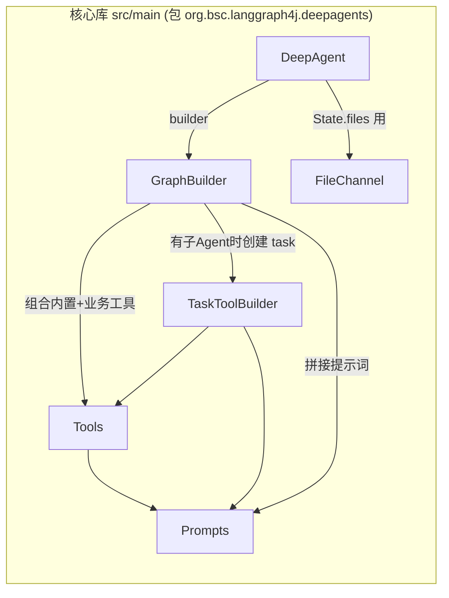

# 02 · 核心模块职责

[← 返回首页](./README.md) | [← 上一章：01 架构总览](./01-架构总览.md)

本章按「模块」粒度说明每个文件的职责与协作关系。类/方法级细节见 [03 · 关键类与函数](./03-关键类与函数.md)。

---

## 模块总览图

---

## A. 核心库层（`src/main`）

### A1. [DeepAgent.java](file:///Users/bytedance/Documents/git_repo/langgraph4j-deepagents/src/main/java/org/bsc/langgraph4j/deepagents/DeepAgent.java) — 顶层门面接口

**职责**：对外暴露的唯一入口与数据契约。它是一个 `interface`，内部聚合了四样东西：

- `State`（内部类）：Deep Agent 的运行时状态，继承 `AgentExecutor.State`，在父类 Schema 基础上增加 `files` Channel；提供 `todos()` / `files()` 便捷读取方法。
- `SubAgent`（record + Builder）：子 Agent 的声明式配置（name / description / prompt / tools）。
- `ToDo`（record）：单条规划项，含 `content` 与 `Status` 枚举（PENDING / IN_PROGRESS / COMPLETED）。
- `builder()`（静态方法）：返回 [GraphBuilder](file:///Users/bytedance/Documents/git_repo/langgraph4j-deepagents/src/main/java/org/bsc/langgraph4j/deepagents/GraphBuilder.java)，是组装 Deep Agent 的起点。
- `log`：全项目共用的 SLF4J Logger。

**协作**：被所有运行入口调用（`DeepAgent.builder()...`）；`State` 被所有工具读写。

---

### A2. [GraphBuilder.java](file:///Users/bytedance/Documents/git_repo/langgraph4j-deepagents/src/main/java/org/bsc/langgraph4j/deepagents/GraphBuilder.java) — 主 Agent 图构建器

**职责**：把用户声明的 `instructions / subAgents / tools / chatModel / builtinTools` 组装成一个 `StateGraph<DeepAgent.State>`。这是「深度」能力的装配车间。

核心逻辑（`build()`）：

1. **筛选内置工具**：若指定了 `builtinTools` 白名单，则只保留匹配名字的内置工具；否则使用全部 `Tools.BUILTIN`。
2. **构建 `task` 工具**：当 `subAgents` 非空时，调用 [TaskToolBuilder](file:///Users/bytedance/Documents/git_repo/langgraph4j-deepagents/src/main/java/org/bsc/langgraph4j/deepagents/TaskToolBuilder.java)，把「内置工具 + 业务工具」作为可供子 Agent 使用的工具池。
3. **拼接系统提示词**：`instructions + Prompts.BASE_PROMPT`。
4. **委托 ReactAgent**：用上述工具集、Schema、系统提示词构造底层 `ReactAgent`，返回其 `StateGraph`。

**协作**：被 `DeepAgent.builder()` 返回；依赖 `Tools`、`TaskToolBuilder`、`Prompts`、以及 langgraph4j 的 `ReactAgent`。

> 📌 注意：代码中有一行被注释掉的 `//allTools.addAll( tools )`（见 [L66](file:///Users/bytedance/Documents/git_repo/langgraph4j-deepagents/src/main/java/org/bsc/langgraph4j/deepagents/GraphBuilder.java#L65-L66)）。这意味着**主 Agent 图本身只挂载了内置工具 + task 工具**；业务工具（如 `internet_search`）实际是通过 `task` 工具池提供给子 Agent 使用的。理解这一点对调试「主 Agent 为什么调不到某工具」很关键。

---

### A3. [Tools.java](file:///Users/bytedance/Documents/git_repo/langgraph4j-deepagents/src/main/java/org/bsc/langgraph4j/deepagents/Tools.java) — 内置工具集

**职责**：提供 Deep Agent 的五个「标配」工具，均为 Spring AI `ToolCallback`，并通过读写 `DeepAgent.State` 来操作虚拟文件系统和规划清单。

| 工具名 | 方法 | 作用 | 读/写状态 |
| --- | --- | --- | --- |
| `ls` | `ls()` | 列出虚拟文件系统所有文件名 | 读 `files` |
| `read_file` | `readFile()` | 按行读取文件（支持 offset/limit，cat -n 格式） | 读 `files` |
| `write_file` | `writeFile()` | 写入/覆盖文件 | 写 `files` |
| `edit_file` | `editFile()` | 精确字符串替换（支持 replaceAll，含唯一性校验） | 写 `files` |
| `write_todos` | `writeTodos()` | 更新规划清单 | 写 `todos` |

所有工具通过 `SpringAIToolResponseBuilder` 或直接读 `context.getContext()` 与状态交互。工具的文字描述来自 [Prompts.java](file:///Users/bytedance/Documents/git_repo/langgraph4j-deepagents/src/main/java/org/bsc/langgraph4j/deepagents/Prompts.java)。

常量 `BUILTIN` 把这五个工具打包成列表，供 `GraphBuilder` 和 `TaskToolBuilder` 消费。

---

### A4. [TaskToolBuilder.java](file:///Users/bytedance/Documents/git_repo/langgraph4j-deepagents/src/main/java/org/bsc/langgraph4j/deepagents/TaskToolBuilder.java) — 子 Agent 调度工具构建器

**职责**：实现「层级委派」支柱。它把一组 `SubAgent` 声明转化为**一个**名为 `task` 的工具。

工作机制：

1. **预编译子 Agent**：遍历每个 `SubAgent`，按其 `tools` 名单从工具池解析出对应 `ToolCallback`（名单为空则给全部工具），为每个子 Agent 构建一个独立的 `ReactAgent`，放入 `agentsMap`（key=子 Agent 名）。
2. **task 工具的执行逻辑**：接收 `{description, subAgentType}` 参数 → 从 `agentsMap` 取出对应子 Agent → 把 `description` 作为 `UserMessage` 连同当前上下文传入 → 调用 `reactAgent.compile().invokeFinal(...)` 执行 → 把子 Agent 产出的 `files` 合并回主状态，并返回其最后一条消息文本。
3. **动态描述**：task 工具的 description 由 `Prompts.TASK_DESCRIPTION_PREFIX/SUFFIX` 加上「可用子 Agent 列表」拼接而成，inputSchema 里也会列出可选的 `subAgentType`。

**协作**：被 `GraphBuilder` 在「有子 Agent」时调用；依赖 `Tools`（工具池）、`Prompts`（描述）、`ReactAgent`（子 Agent 载体）。

---

### A5. [FileChannel.java](file:///Users/bytedance/Documents/git_repo/langgraph4j-deepagents/src/main/java/org/bsc/langgraph4j/deepagents/FileChannel.java) — 虚拟文件系统 Channel

**职责**：定义 `files` 状态键在 LangGraph4j 状态图中的**合并（reduce）语义**。

- 实现 `Channel<Map<String,String>>`。
- 默认值：空 Map。
- Reducer：`mergeMap(map1, map2, (v1,v2) -> v2)` —— 新旧两个文件 Map 增量合并，**键冲突时以新值覆盖旧值**。

这保证了：多次 `write_file` 会累积不同文件；对同一文件重复写会覆盖；子 Agent 回写的文件会并入主状态。是「持久化记忆」支柱的底层基石。

---

### A6. [Prompts.java](file:///Users/bytedance/Documents/git_repo/langgraph4j-deepagents/src/main/java/org/bsc/langgraph4j/deepagents/Prompts.java) — 内置提示词常量

**职责**：集中存放「上下文工程」支柱所需的全部内置提示词（均为 `String` 常量），与 Python 原版逐字对齐。

| 常量 | 用途 |
| --- | --- |
| `BASE_PROMPT` | 拼接到主 Agent 系统提示词末尾，介绍 `write_todos` 与 `task` 工具的使用规范 |
| `WRITE_TODOS_DESCRIPTION` | `write_todos` 工具的详尽描述（含大量何时用/不用的示例） |
| `TASK_DESCRIPTION_PREFIX` / `TASK_DESCRIPTION_SUFFIX` | `task` 工具描述的前后缀（中间插入可用子 Agent 列表） |
| `EDIT_DESCRIPTION` | `edit_file` 工具描述 |
| `TOOL_DESCRIPTION` | `read_file` 工具描述 |

**协作**：被 `Tools`、`TaskToolBuilder`、`GraphBuilder` 引用。要「让 Agent 适配你的领域」，README 建议的就是改这里（或改业务 `instructions`）。

---

## B. 能力适配层（`src/test`，但承担「插件」角色）

虽然放在 `src/test`，这些类是把核心库接入真实 LLM / 搜索引擎的适配器，也是示例的组成部分。

| 文件 | 职责 |
| --- | --- |
| [AiModel.java](file:///Users/bytedance/Documents/git_repo/langgraph4j-deepagents/src/test/java/org/bsc/langgraph4j/deepagents/AiModel.java) | 枚举 4 种 LLM 提供商（OPENAI/OLLAMA/GITHUB_MODEL/GEMINI），封装各自 `ChatModel` 的构建逻辑与 API Key 读取 |
| [ChatModelConfiguration.java](file:///Users/bytedance/Documents/git_repo/langgraph4j-deepagents/src/test/java/org/bsc/langgraph4j/deepagents/ChatModelConfiguration.java) | Spring `@Configuration`，按 profile（`openai`/`ollama`/`gemini`/`github-models`）装配 `ChatModel` Bean |
| [AiPrompt.java](file:///Users/bytedance/Documents/git_repo/langgraph4j-deepagents/src/test/java/org/bsc/langgraph4j/deepagents/AiPrompt.java) | 示例业务提示词枚举：`MAIN_AGENT`（主研究员）、`RESEARCH_AGENT`（研究子 Agent）、`CRITIQUE_AGENT`（评审子 Agent） |
| [AiTools.java](file:///Users/bytedance/Documents/git_repo/langgraph4j-deepagents/src/test/java/org/bsc/langgraph4j/deepagents/AiTools.java) | 定义 `internet_search` 工具（`ToolCallback`），底层调用 Tavily |
| [ToolsComponent.java](file:///Users/bytedance/Documents/git_repo/langgraph4j-deepagents/src/test/java/org/bsc/langgraph4j/deepagents/ToolsComponent.java) | Spring `@Component`，把 `TavilyApi` Bean 注入 `AiTools` |
| [TavilyApi.java](file:///Users/bytedance/Documents/git_repo/langgraph4j-deepagents/src/test/java/org/bsc/langgraph4j/deepagents/TavilyApi.java) | Tavily 搜索 API 的请求/响应数据模型（record + Builder + 自定义反序列化） |
| [TavilyApiHttpClient.java](file:///Users/bytedance/Documents/git_repo/langgraph4j-deepagents/src/test/java/org/bsc/langgraph4j/deepagents/TavilyApiHttpClient.java) | 基于 JDK `HttpClient` 的 Tavily 实现（供 Javelit 用） |
| [TavilyApiRestClient.java](file:///Users/bytedance/Documents/git_repo/langgraph4j-deepagents/src/test/java/org/bsc/langgraph4j/deepagents/TavilyApiRestClient.java) | 基于 Spring `RestClient` 的 Tavily 实现（`@Component`，供 Spring Boot 用） |

---

## C. 运行入口层（`src/test`）

| 文件 | 职责 | 运行方式 |
| --- | --- | --- |
| [DeepagentsDemoApplication.java](file:///Users/bytedance/Documents/git_repo/langgraph4j-deepagents/src/test/java/org/bsc/langgraph4j/deepagents/DeepagentsDemoApplication.java) | Spring Boot 启动类 | `@SpringBootApplication` |
| [DeepagentsConsoleController.java](file:///Users/bytedance/Documents/git_repo/langgraph4j-deepagents/src/test/java/org/bsc/langgraph4j/deepagents/DeepagentsConsoleController.java) | `CommandLineRunner`，演示三种用法（无子 Agent / 单子 Agent / 双子 Agent） | Spring Boot CLI |
| [JtDeepAgentsApp.java](file:///Users/bytedance/Documents/git_repo/langgraph4j-deepagents/src/test/java/JtDeepAgentsApp.java) | Javelit（JBang）交互式 Web UI，可选模型 + 输入问题 + 流式展示 | JBang + Javelit |
| [JtTavilyApp.java](file:///Users/bytedance/Documents/git_repo/langgraph4j-deepagents/src/test/java/JtTavilyApp.java) | 仅演示 Tavily 搜索的 Javelit UI | JBang + Javelit |
| [JtSelectModel.java](file:///Users/bytedance/Documents/git_repo/langgraph4j-deepagents/src/test/java/JtSelectModel.java) | Javelit 的模型选择组件（Cloud/Local） | 被 JtDeepAgentsApp 复用 |
| [JtTools.java](file:///Users/bytedance/Documents/git_repo/langgraph4j-deepagents/src/test/java/JtTools.java) | Javelit 场景下的 `AiTools` 实现（用 HttpClient 版 Tavily） | 被 JtDeepAgentsApp 复用 |
| [ToolsTest.java](file:///Users/bytedance/Documents/git_repo/langgraph4j-deepagents/src/test/java/org/bsc/langgraph4j/deepagents/ToolsTest.java) | JUnit 单测：校验 JSON Schema 生成与 FileChannel 合并语义 | Maven test |

> 运行方式的完整步骤见 [05 · 运行与配置](./05-运行与配置.md)。

---

[← 返回首页](./README.md) | [下一章：03 · 关键类与函数 →](./03-关键类与函数.md)
