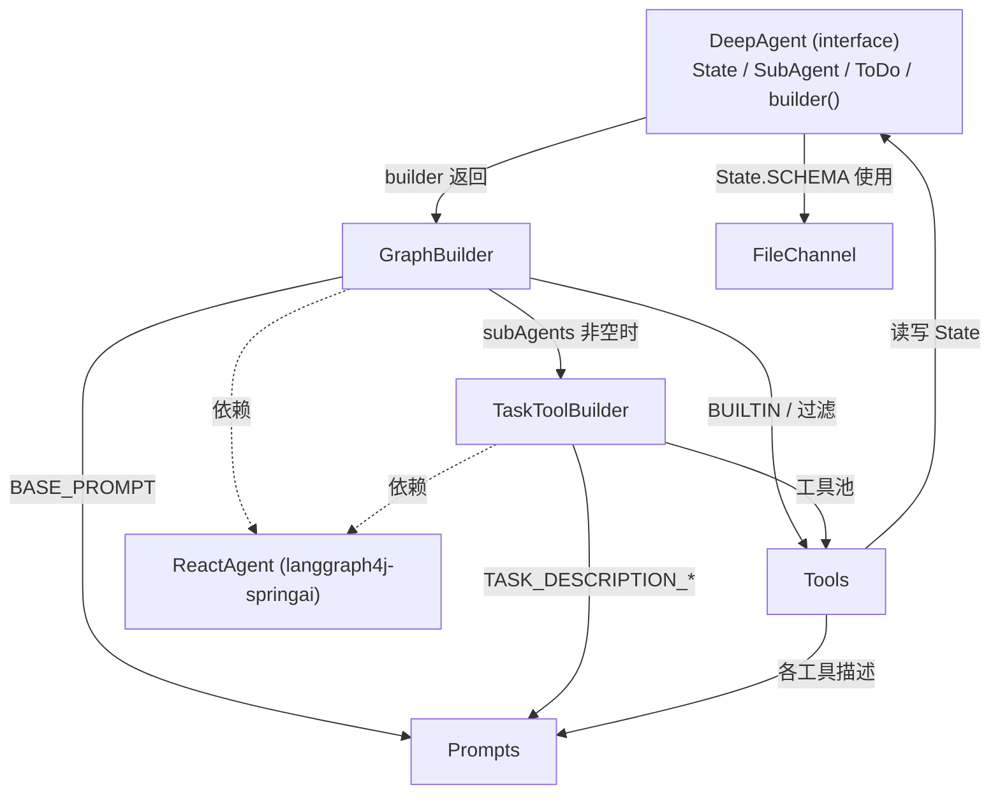
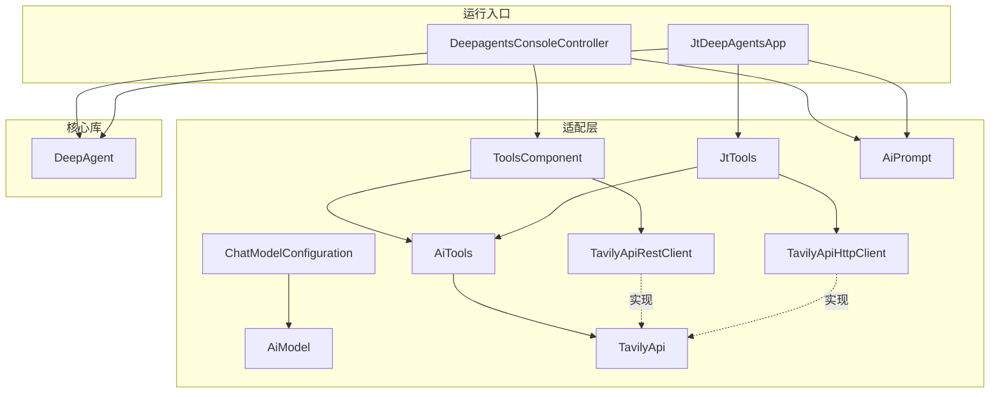

# 04 · 依赖关系

[← 返回首页](./README.md) | [← 上一章：03 关键类与函数](./03-关键类与函数.md)

本章从三个层面说明依赖：**外部依赖（Maven）**、**内部依赖（类之间）**、**外部服务依赖（运行时）**。

---

## 1. Maven 构建与依赖

坐标与属性（见 [pom.xml](file:///Users/bytedance/Documents/git_repo/langgraph4j-deepagents/pom.xml)）：

```
groupId:    org.bsc.langgraph4j
artifactId: spring-ai-deepagents
version:    1.0-SNAPSHOT
packaging:  jar
Java:       17 (source/target)
```

关键版本属性：

| 属性 | 值 | 作用 |
| --- | --- | --- |
| `langgraph4j.version` | `1.7-SNAPSHOT` | LangGraph4j 核心（含 ReactAgent、State、Channel） |
| `spring-ai.version` | `1.0.0`（BOM 实际 import `1.1.0`） | Spring AI |
| `spring-boot.version` | `3.3.4` | Spring Boot |

### 1.1 依赖管理（dependencyManagement，import BOM）

- `langgraph4j-bom`（`${langgraph4j.version}`）
- `spring-boot-starter-parent`（`3.3.4`）
- `spring-ai-bom`（`1.1.0`）

### 1.2 运行期依赖

| 依赖 | scope | 说明 |
| --- | --- | --- |
| `langgraph4j-springai-agentexecutor` | compile | **核心依赖**，提供 `ReactAgent`、`AgentExecutor.State`、Spring AI 序列化器、`SpringAIToolResponseBuilder` 等 |
| `spring-boot-devtools` | runtime(optional) | 开发热重载 |

### 1.3 测试/示例期依赖（scope=test）

| 依赖 | 用途 |
| --- | --- |
| `spring-ai-ollama` | Ollama 本地模型 |
| `spring-ai-openai` | OpenAI / GitHub Models（OpenAI 兼容接口） |
| `spring-ai-vertex-ai-gemini` | Google Gemini |
| `spring-ai-azure-openai` | Azure OpenAI |
| `spring-boot-starter-web` | Studio / Web 应用形态 |
| `spring-boot-starter-test` | JUnit 测试 |
| `langgraph4j-studio-springboot` | LangGraph4j 可视化 Studio |

### 1.4 Profile：`javelit`（JDK 21+ 自动激活）

```xml
<profile>
  <id>javelit</id>
  <activation><jdk>[21,)</jdk></activation>
  <dependencies>
    <dependency>org.bsc.langgraph4j:langgraph4j-javelit:1.7-SNAPSHOT (test, optional)</dependency>
  </dependencies>
</profile>
```

> `langgraph4j-javelit` 提供交互式 Web UI 组件（`io.javelit.core.Jt` 等），仅在 JDK 21+ 时引入。[JtDeepAgentsApp](file:///Users/bytedance/Documents/git_repo/langgraph4j-deepagents/src/test/java/JtDeepAgentsApp.java) 等 JBang 脚本顶部的 `//DEPS` 还会额外声明 `plantuml-mit`（用于渲染 PlantUML 图）。

---

## 2. 内部依赖关系（类级）

### 2.1 核心库依赖图



**依赖方向要点**：

- `DeepAgent` 是门面，`GraphBuilder` / `TaskToolBuilder` / `Tools` 都环绕 `DeepAgent.State` 工作。
- `Prompts` 是「叶子」，被三处引用，自身不依赖任何类。
- `FileChannel` 只被 `DeepAgent.State.SCHEMA` 引用。
- `GraphBuilder` 和 `TaskToolBuilder` 都最终委托 langgraph4j 的 `ReactAgent` 构建状态图——**这是整个项目与 LangGraph4j 的核心耦合点**。

### 2.2 示例层 → 核心库 的依赖



- Spring Boot 路线：`DeepagentsConsoleController` ← 注入 `ChatModel`（来自 `ChatModelConfiguration`/`AiModel`）+ `ToolsComponent`（内含 `TavilyApiRestClient`）。
- Javelit 路线：`JtDeepAgentsApp` ← `JtSelectModel`（选模型）+ `JtTools`（内含 `TavilyApiHttpClient`）。

---

## 3. 外部服务依赖（运行时）

| 服务 | 必需性 | 用途 | 配置项 |
| --- | --- | --- | --- |
| **LLM 提供商**（四选一） | 必需 | 驱动 Agent 推理 | 见下 |
| ├ OpenAI | 可选 | 默认 `gpt-4o-mini` | `OPENAI_API_KEY` |
| ├ Ollama | 可选 | 本地模型（`qwen3:8b` 等） | 本地 `http://localhost:11434`，无需 Key |
| ├ Gemini (Vertex AI) | 可选 | `gemini-2.5-pro` | `GOOGLE_CLOUD_PROJECT` + `GOOGLE_CLOUD_LOCATION` |
| └ GitHub Models | 可选 | OpenAI 兼容端点 | `GITHUB_MODELS_TOKEN` |
| **Tavily** | 示例必需 | Web 搜索（`internet_search`） | `TAVILY_API_KEY` |

> 这些是「插拔式」依赖：核心库（`src/main`）不绑定任何具体 LLM 或搜索引擎；具体选择都在 `src/test` 的适配层完成。README 明确支持「自带 LLM / 自带记忆存储」。

---

## 4. 依赖层次小结

```
┌─────────────────────────────────────────────┐
│  运行入口 (Spring Boot CLI / Javelit / JUnit)  │
├─────────────────────────────────────────────┤
│  适配层 (AiModel/AiTools/Tavily* ... )          │  ← 绑定 OpenAI/Ollama/Gemini/GitHub + Tavily
├─────────────────────────────────────────────┤
│  核心库 spring-ai-deepagents                    │  ← DeepAgent/GraphBuilder/TaskToolBuilder/Tools/FileChannel/Prompts
├─────────────────────────────────────────────┤
│  langgraph4j-springai-agentexecutor (ReactAgent)│  ← ReAct 循环引擎
├─────────────────────────────────────────────┤
│  Spring AI 1.1.0 + Spring Boot 3.3.4 + JDK 17   │  ← 基础设施
└─────────────────────────────────────────────┘
```

---

[← 返回首页](./README.md) | [下一章：05 · 运行与配置 →](./05-运行与配置.md)
